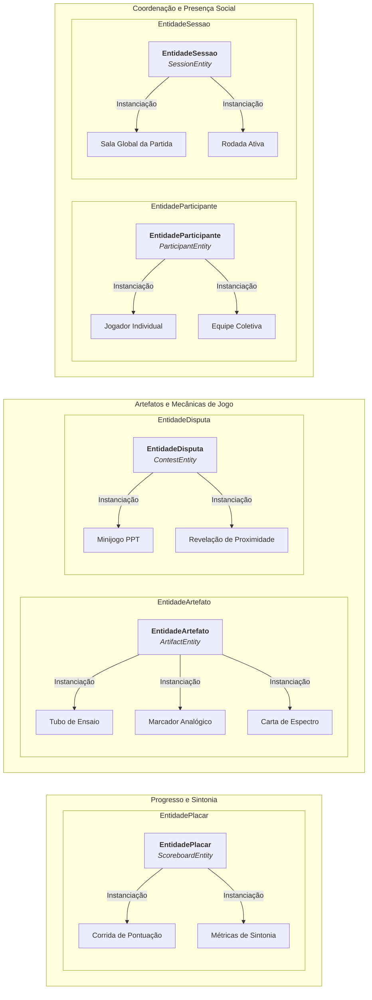
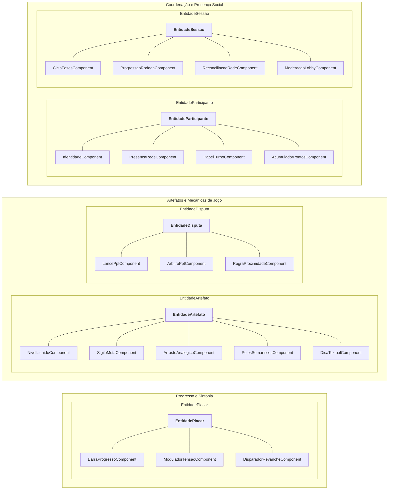
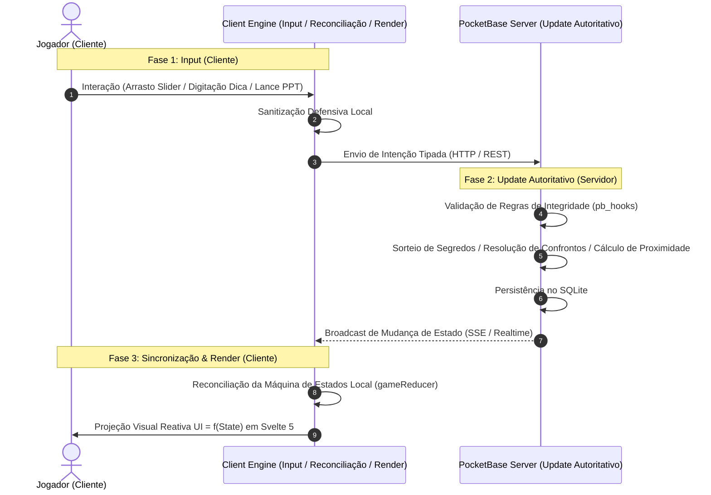

# Diagramas de Arquitetura, Entidades e Componentes

Este documento consolida a modelagem visual do jogo **Leveling Out**, unificando as representações gráficas de entidades, instanciações de domínio, composição por componentes e o fluxo distribuído do motor.

Para as especificações textuais detalhadas de cada conceito, consulte:

- [Especificação de Entidades do Jogo](../entidades/entidades.md)
- [Catálogo de Componentes Atômicos](../componentes/componentes.md)
- [SGDD Consolidado do Jogo](../sgdd/sgdd.md)
- [Arquitetura Técnica do Motor](../agents/architecture.md)

---

## 1. Visão Arquitetural: Entidades Abrangentes e Componentes Atômicos

A modelagem de _Leveling Out_ adota o princípio de **Composição por Componentes**:

1. **Entidades Amplas e Polimórficas:** As 5 entidades conceituais cobrem todo o domínio da aplicação. Elas não contêm regras hardcoded de mecânicas; sua especialização emerge de sua instanciação e dos componentes acoplados.
2. **Componentes Atômicos:** Os 19 componentes são imperativamente atômicos e de propósito único, sendo os reais responsáveis por conferir capacidades e comportamentos a uma entidade.
3. **Distribuição em Grid:** Para otimizar a visualização em telas convencionais e evitar diagramas excessivamente horizontais, as representações são organizadas em um grid semântico de três camadas:
   - _Coordenação e Presença Social_ (Participante e Sessão)
   - _Mecânicas de Jogo e Interação_ (Artefato e Disputa)
   - _Resultados e Evolução_ (Placar)

---

## 2. Diagrama de Entidades e Instanciações de Domínio

O diagrama a seguir ilustra como as **5 Grandes Entidades Conceituais** se ramificam em papéis e instâncias concretas no ciclo de vida do jogo:

---

## 3. Diagrama de Composição: Entidades $\times$ Componentes Atômicos

O diagrama abaixo detalha a associação direta entre cada entidade conceitual e os componentes atômicos que definem suas capacidades:

---

## 4. Diagrama de Sequência do Game Loop Distribuído

O diagrama a seguir detalha a cadência temporal do Game Loop de _Leveling Out_ em um sistema distribuído autoritativo em tempo real, demonstrando a interação cronológica entre o Jogador, o motor cliente (`GameEngine`) e o servidor PocketBase:

> Para a especificação detalhada da implementação de cada fase, controladores POO e regras de Zero Trust, consulte [Arquitetura Técnica do Motor](../agents/architecture.md).

---

## 5. Diagrama de Topologia de Fluxo no Sistema Distribuído

A operação dos módulos e subsistemas obedece à separação estrita de responsabilidades entre cliente e servidor:

```mermaid
flowchart LR
    subgraph Cliente_Input ["Front-end: Input"]
        direction TB
        I1["Gesto do Jogador / Teclado"]
        I2["Sanitização Defensiva (sanitize.ts)"]
        I3["Fábrica de Intenções (intent-factory.ts)"]
        I1 --> I2 --> I3
    end

    subgraph Servidor_Update ["Back-end PocketBase: Update"]
        direction TB
        U1["Recebe Ação via HTTP REST"]
        U2["Hooks Autoritários (game_rules.pb.js)"]
        U3["Cálculo de Margem & Sorteio Seguro"]
        U4["Gravação no Banco SQLite"]
        U1 --> U2 --> U3 --> U4
    end

    subgraph Cliente_SyncRender ["Front-end: Sync & Render"]
        direction TB
        S1["Assinatura SSE (PocketBase SDK)"]
        S2["Reducer Determinístico (state-machine.ts)"]
        S3["Projeções Puras (projections.ts)"]
        S4["Componentes Svelte 5 (UI reativa)"]
        S1 --> S2 --> S3 --> S4
    end

    I3 -->|Despacho HTTP POST| U1
    U4 -->|Difusão em Tempo Real via SSE| S1
```

