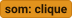
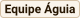
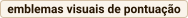

# Leveling Out

## Short Game Design Document

### Integrantes

- **Gabriel Melo** - 536093
- **Emilly Lima** - 540576

---

## 1. História

Num mundo saturado de opiniões divergentes, duas equipes rivais de amigos decidem colocar sua sintonia à prova em um laboratório de calibragem social. O desafio consiste em sintonizar seus achismos e decodificar a mente dos seus parceiros de equipe, alinhando conceitos subjetivos do cotidiano ao longo de uma escala percentual contínua de um tubo de ensaio. A equipe que alcançar primeiro a sintonia perfeita acumula a pontuação máxima e prova quem realmente tem a melhor telepatia social.

---

## 2. Jogo

> **Convenção de Cores do Documento:**
>
> - : Elementos visuais e de interface gráfica (Bege claro base).
> - : Ações do jogador, mecânicas e lógica do sistema (Roxo acento).
> - : Músicas de fundo e efeitos sonoros (Laranja primário).

Começa o jogo com a  exibindo o , em seguida a   com um  o  e um  . Ao , o jogador é direcionado para o , onde visualiza o , um   e o , onde os participantes  entre a  e a  em .

Havendo participantes em ambos os lados, tem início a  : cada equipe escolhe um representante para disputar um minijogo de Pedra, Papel e Tesoura através de  . O jogo : em caso de , o confronto se ; em caso de , a equipe vencedora ganha o direito de começar e  .

A equipe vencedora vê a  contendo uma  com dois polos conceituais opostos (como "Anônimo" e "Famoso"). Definido o espectro, inicia-se a rodada . O jogo  entre 5% e 95% e define quem da equipe será o Codificador e quem será o Palpiteiro.

Na tela exclusiva do Codificador surge um  com  até a altura secreta, com   e um . Para os outros jogadores, o conteúdo do tubo fica escondido com uma . O Codificador avalia os dois extremos da carta,  (ex.: para 70% entre Anônimo e Famoso, digita "Keanu Reeves") e  .

A pista é exibida em um  para todos. O Palpiteiro da equipe assume o controle e manipula um ,  para calibrar seu palpite , sentindo o celular . Ao encontrar a posição estimada, o Palpiteiro  .

O jogo inicia a revelação dramática : o , o  e uma  indica o valor chutado. O jogo  e premia a equipe com :

- Se acertar "Na Mosca" (diferença de até 2%), ganham  ;
- Se ficar "Muito Perto" (diferença de até 6%), ganham  ;
- Se ficar "Perto" (diferença de até 12%), ganham  ;
- Se errar por mais de 12%, ganham   com o aviso .

A pontuação  de cada equipe em uma corrida animada até a meta de 10 pontos. Se nenhuma equipe alcançou 10 pontos, o jogo  e a outra equipe joga a próxima rodada.

Quando uma equipe , a partida termina e abre a  consagrando os campeões , com o  exibindo o maior acerto e a maior gafe da partida, além do  , que  na mesma sala, e o .

---

## 3. Listas de Produção (Backlog Derivado do Texto)

###  Arte

- [ ] Tela de Carregamento Inicial (Loading)
- [ ] Logotipo oficial do jogo em tipografia Bagel Fat One
- [ ] Tela de Entrada Principal (Title Card)
- [ ] Campo de entrada e rótulos de Apelido do Jogador
- [ ] Botão de Ação: Criar Sala / Entrar na Sala
- [ ] Tela de Lobby Multiplayer
- [ ] Identificador de Sala em fonte Fira Code
- [ ] Botão de Copiar Link de Convite com estado reativo de confirmação
- [ ] Painel Tripartite de Escolha de Equipes (Corvo, Aleatório em tons de cinza e Águia com watermarks dedicadas)
- [ ] Botão de Iniciar Partida exclusivo do anfitrião (verde com ícone à direita e quórum de 4 jogadores)
- [ ] Arena de Minijogo de Iniciativa (PPT)
- [ ] Três botões com ícones vetoriais de Pedra, Papel e Tesoura
- [ ] Tela de Escolha de Espectro
- [x] Tubo de Ensaio Procedural em SVG com graduação de 10% em 10% (TestTube.svelte)
- [x] Renderização de Líquido Procedural em SVG com dupla camada de menisco senoidal contínuo
- [ ] Animação vetorial contínua de micro-borbulhas de fluido
- [ ] Modulador de Tensão Visual: aceleração do menisco em função dos pontos da equipe (5.0s a 0.25s)
- [ ] Mensagem de Status de Ocultamento de Visão da Meta
- [ ] Campo de Entrada de Dica Contextualizada com contador de caracteres
- [ ] Balão de Fala de Exibição da Pista Enviada
- [ ] Marcador Analógico (Slider contínuo com trilha, escala e ponteiro deslizante)
- [ ] Linha visual de sobreposição de Palpite no tubo com cota percentual
- [ ] Emblemas visuais de pontuação: "Na Mosca!", "Muito Perto!", "Perto" e "Fora da Margem!"
- [ ] Placar de Corrida Vertical das Equipes com ícones de avanço
- [ ] Tela de Vitória Final com consagração da equipe campeã
- [ ] Painel de Métricas de Sintonia (melhor acerto e maior gafe da partida)
- [ ] Botão: Revanche Imediata
- [ ] Botão: Retornar ao Lobby Principal

###  Programação

- [ ] Inicialização do cliente SvelteKit e verificação de saúde do backend PocketBase
- [ ] Sanitização defensiva de apelidos de jogador contra injeção de tags HTML (máximo 20 caracteres)
- [ ] Geração dinâmica de slug de sala na URL (`/[sala]`) e inserção no banco de dados SQLite
- [ ] Cópia para a área de transferência (`navigator.clipboard.writeText`) com feedback visual temporário
- [ ] Sincronização de presença de jogadores em tempo real via Server-Sent Events (SSE)
- [ ] Controle autoritativo de quórum (máx 4 jogadores por sala e máx 2 por equipe), sorteio estocástico de aleatórios e início pelo host
- [ ] Envio de intenções tipadas (`GameAction`) via REST para o backend
- [ ] Rota autoritativa POST `/api/ppt/lance` e arbitragem em memória thread-safe (`$app.store()`)
- [ ] Resolução de confronto de PPT com desempate e reemissão automática
- [ ] Sorteio estocástico de cartas bipolares a partir do catálogo temático
- [ ] Criação autoritativa de rodadas e sorteio da meta percentual secreta no intervalo [5%, 95%]
- [ ] Blindagem de sigilo Zero Trust da meta oculta (ocultação inviolável antes da revelação oficial)
- [ ] Sanitização defensiva de pistas textuais (remoção de HTML e truncamento em 60 caracteres)
- [ ] Transição autoritativa de fase de Dica para Palpite no backend (`game_rules.pb.js`)
- [ ] Controlador de física e arrasto analógico (`SliderDragController`) com clamp matemático em [0, 100]
- [ ] Acionamento de feedback háptico por vibração móvel (`navigator.vibrate`) a cada dezena percorrida
- [ ] Submissão do palpite e transmissão via SSE da fase de revelação para todos os clientes
- [x] Integração temporal contínua da fase do menisco (requestAnimationFrame) e física aditiva de agitação no lobby
- [ ] Dinamização da velocidade da onda do menisco em função do placar da equipe (5.0s a 0.25s)
- [ ] Animação vetorial SVG do menisco subindo até o valor real do líquido
- [ ] Algoritmo autoritativo de acerto aproximado por faixas de tolerância (|meta - palpite|: <=2%, <=6%, <=12%, >12%)
- [ ] Atualização autoritativa em cascata dos placares na coleção `salas`
- [ ] Interpolação numérica suave do placar via Svelte Runes / tweened
- [ ] Alternância de posse de turno (_momentum_) e avanço do número da rodada
- [ ] Verificação de condição de vitória ao atingir a meta de 10 pontos
- [ ] Disparo de ação de Revanche (`REMATCH_INTENT`) com reset dos placares e reinício no PPT
- [ ] Hook de higienização periódica (`cleanup.pb.js`) apagando salas inativas há mais de 15 minutos

###  Áudio

- [ ] Música ambiente de lobby e espera
- [ ] Música de contagem regressiva rápida da disputa de PPT
- [ ] Música de concentração e tensão da rodada ativa
- [ ] Música de suspense com crescendo dramático para a revelação do tubo
- [ ] Música épica de vitória da partida
- [ ] Efeito sonoro (SFX): clique de botão e interações gerais
- [ ] Efeito sonoro (SFX): confirmação de cópia de link da sala
- [ ] Efeito sonoro (SFX): seleção de lance de Pedra, Papel e Tesoura
- [ ] Efeito sonoro (SFX): fanfarra de vitória na disputa de PPT
- [ ] Efeito sonoro (SFX): líquido borbulhando dentro do tubo de ensaio
- [ ] Efeito sonoro (SFX): envio confirmado da dica conceitual
- [ ] Efeito sonoro (SFX): ruído mecânico de deslizamento contínuo do slider
- [ ] Efeito sonoro (SFX): trava de confirmação do palpite analógico
- [ ] Efeito sonoro (SFX): revelação dramática com acerto "Na Mosca!" (+4 pontos com sino)
- [ ] Efeito sonoro (SFX): revelação com acerto de média precisão (+3 pontos)
- [ ] Efeito sonoro (SFX): revelação com acerto básico (+2 pontos)
- [ ] Efeito sonoro (SFX): revelação com erro fora da margem (0 pontos e som abafado)
- [ ] Efeito sonoro (SFX): clique de ativação de revanche imediata
